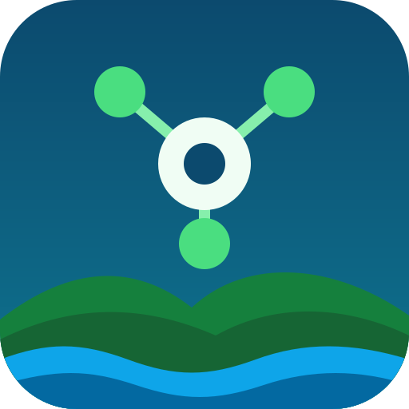
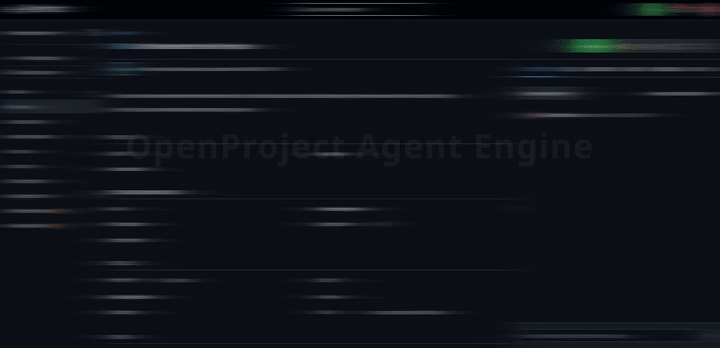

<p align="center">
  
</p>

<h1 align="center">OpenProject Agent Engine</h1>

<p align="center">
  <em>Work packages in. Merged pull requests out.</em>
</p>

<p align="center">
  <a href="https://hub.docker.com/r/kookster310/op-agent-engine"></a>
  <a href="https://hub.docker.com/r/kookster310/op-agent-engine/tags"></a>
</p>

---

Polls OpenProject work packages and dispatches the pi coding agent to work on
them. OpenProject is the system of record:
the engine claims work, prepares a per-agent clone, renders a prompt, runs the
agent, verifies the outcome against GitHub and OpenProject, and performs
**every** status transition itself. Agents never change status.

<p align="center">
  
</p>

## Requirements

- Docker
- OpenProject 17 (API v3) with a project, plus one-time administrator access.
- GitHub repository for each project and a token that can push to it and merge pull requests.

## Quick start

1. Complete the one-time instance setup — statuses, the `GIT_REPO` project
   custom field, the `AGENT` work-package custom field and the Agent Worker
   role — in [docs/OPENPROJECT_SETUP.md](docs/OPENPROJECT_SETUP.md).

2. In `docker/`, run the interactive setup:

   ```bash
   git clone https://github.com/310networks/openproject-agent-engine op-agent-engine 
   cd op-agent-engine/docker && ./agent-init.sh
   ```

   Re-running is safe. It pulls the current image first, so it is also the
   upgrade step that creates any agents added by a new release.
   `--reprompt-tokens` asks for the OpenProject tokens again.

3. Finish `docker/.env` before starting the stack. Add `GH_TOKEN` (and the 
   optional `GH_TOKEN_REVIEWER`, `GIT_REVIEWER_NAME` and `GIT_REVIEWER_EMAIL` 
   for a dedicated reviewer account, ie: branch protection rules, see below).

4. Start the stack:

   ```bash
   docker compose up -d
   docker compose logs -f engine
   ```

5. Notes

   After adding a project or changing its `GIT_REPO` / `AGENT` setup in
   OpenProject, run `docker compose restart engine`. 
   After changing `docker/.env`, run `docker compose up -d engine` so compose 
   recreates the container with the new environment.

The dashboard is served at `http://127.0.0.1:8765`
(see [docs/DASHBOARD.md](docs/DASHBOARD.md)).

## Required environment variables

`agent-init.sh` writes the OpenProject settings, the agent tokens and the
provider key. It leaves the GitHub token(s) to you: add them to `docker/.env`
before starting the stack.

| Variable | Meaning |
|---|---|
| `OP_BASE_URL` | your OpenProject URL |
| `OP_PROJECT` | project identifier(s): one, a comma list, or `*` for every project with `GIT_REPO` |
| `OP_ENGINE_TOKEN` | API token of the runtime user (administrator) |
| `AGENT_MODEL` | model for every agent as `<provider>/<model>`; the provider also selects the credential or endpoint variable |
| `AGENT_MODEL_<AGENT>` | optional per-agent model (`AGENT_MODEL_FRONTEND`, `..._BACKEND`, `..._DESIGNER`, `..._VFX`, `..._AUDIO`, `..._REVIEWER`) from the same provider |
| `OP_TOKEN_FRONTEND` | token of `frontendEngineer` |
| `OP_TOKEN_BACKEND` | token of `backendEngineer` |
| `OP_TOKEN_DESIGNER` | token of `leadDesigner` |
| `OP_TOKEN_VFX` | token of `vfxArtist` |
| `OP_TOKEN_AUDIO` | token of `audioDesigner` |
| `OP_TOKEN_REVIEWER` | token of `codeReviewer` |
| `OPENROUTER_API_KEY` (or other provider key) | one model provider key for pi |
| `LLAMA_BASE_URL` | llama.cpp router URL, when using the local llama.cpp provider |
| `GH_TOKEN` | GitHub token used to clone, push and look up pull requests |

For repositories with branch protection that requires the approving or merging
account to differ from the pull request's author, give `codeReviewer` its own
GitHub account: `GH_TOKEN_REVIEWER` (plus optional `GIT_REVIEWER_NAME` and
`GIT_REVIEWER_EMAIL`). The reviewer then switches `gh`/git to that account and
can submit an approving review before merging; without it every agent keeps
using `GH_TOKEN`. Add these values to `docker/.env` yourself; the setup script
no longer asks for GitHub tokens. If both tokens belong to the same account,
branch protection that requires a different approver still blocks the merge.

Each monitored project must have a **project attribute** named `GIT_REPO`
containing its GitHub repository
(`owner/name` or a github.com URL). Create it once in
**Administration → Projects → Project attributes** and choose **For all
projects**.
One attribute is assigned to every project, so there is no per-project enablement —
the same one-time step as the `AGENT` field. `docker/agent-init.sh`
explains this during setup.

The team is fixed in the image, one OpenProject account and one token each:

| `AGENT` field value | Login | Kind |
|---|---|---|
| `FRONTEND` | `frontendEngineer` | implementer |
| `BACKEND` | `backendEngineer` | implementer |
| `LEAD_DESIGNER` | `leadDesigner` | implementer |
| `VFX` | `vfxArtist` | implementer |
| `AUDIO` | `audioDesigner` | implementer |
| `REVIEWER` | `codeReviewer` | reviewer |

For reference, the model the script writes looks like
`AGENT_MODEL=openrouter/deepseek/deepseek-v4.1-flash-1017`.

A local [llama.cpp](https://github.com/ggml-org/llama.cpp) router is a built-in
provider instead of a hosted key: set `AGENT_MODEL=llama.cpp/<model>` and
`LLAMA_BASE_URL` to the router URL (plus `LLAMA_API_KEY` if the server was
started with `--api-key`). The URL must be reachable from inside the engine
container; see [docs/CONFIG.md](docs/CONFIG.md#llamacpp).

Everything else — concurrency, timings, status names, paths and the shared git
identity — has a working default. See [docs/CONFIG.md](docs/CONFIG.md) and the commented
[`docker/.env.example`](docker/.env.example).

## How a ticket flows

| Observed state | Engine action | Run | Verified outcome | Transition |
|---|---|---|---|---|
| `New`, eligible, `AGENT` set | claim, `In Progress` | implement | open PR / `BLOCKED` | `Ready for Review` / `On Hold` |
| `New`, unfinished blocker(s) | block, `Blocked` + comment | — | — | `Blocked` |
| `Blocked`, every blocker `Closed` | claim, `In Progress` | implement | open PR / `BLOCKED` | `Ready for Review` / `On Hold` |
| `Ready for Review`, PR exists | claim, `In Testing` | review | PR merged / `REJECTED` | `Closed` / `Rejected` |
| `Ready for Review`, no PR | — | — | — | `On Hold` + comment |
| `Rejected`, eligible | claim, `In Progress` | fix | as implement | as implement |

`On Hold` is terminal: the engine ignores the ticket until a human moves it.
Branches are `op-<project>-<wp>` (one per ticket). Every run uses its own git
worktree, which is removed when the run ends; at most `MAX_RUNS_PER_AGENT` runs
per agent (default 1) share that agent's clone. Every engine comment starts
with `ENGINE:`.

## Documentation

| Doc | Contents |
|---|---|
| [docs/DOCKER.md](docs/DOCKER.md) | image internals, volumes, releases, troubleshooting |
| [docs/OPENPROJECT_SETUP.md](docs/OPENPROJECT_SETUP.md) | statuses, `GIT_REPO` project attribute, `AGENT` work-package custom field, Agent Worker role, admin engine user |
| [docs/CONFIG.md](docs/CONFIG.md) | every environment variable, provider keys, agent team, CLI reference |
| [docs/DASHBOARD.md](docs/DASHBOARD.md) | read-only web UI |
| [docs/RUNBOOK.md](docs/RUNBOOK.md) | status, pause, run inspection, `On Hold` handling, recovery |
| [docs/ACCEPTANCE.md](docs/ACCEPTANCE.md) | fake-agent test and manual acceptance checklist |
| [docs/CURRENT_STATE.md](docs/CURRENT_STATE.md) | implemented architecture, control flow, state and limits |

## Contributing

Issues and pull requests are welcome. Pull requests run the test suite
(`ruff`, `mypy`, `pytest`). Changes to `.github/`, `docker/` or
`pyproject.toml` need review from a code owner, see
[.github/CODEOWNERS](.github/CODEOWNERS).

## Security

Do not open a public issue for a vulnerability — use
[private reporting](SECURITY.md) instead.

## License

OpenProject Agent Engine is open source software released under the
[MIT License](LICENSE).
